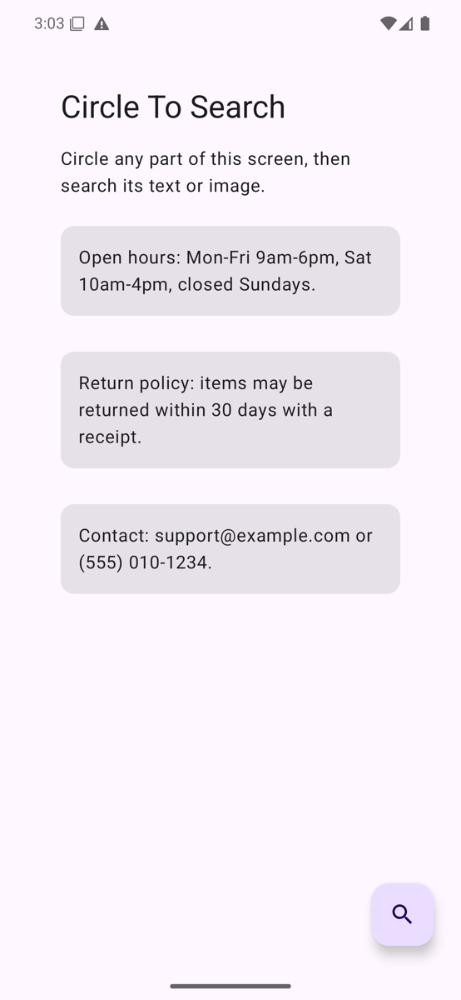
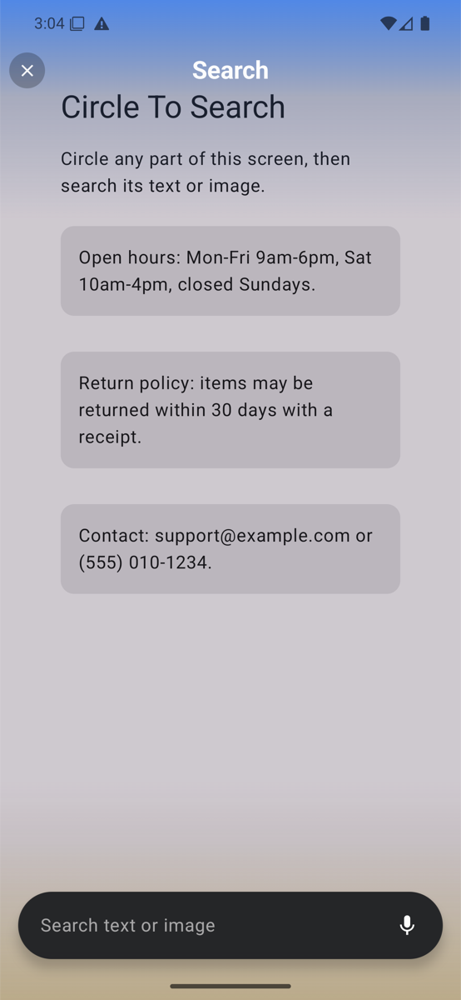
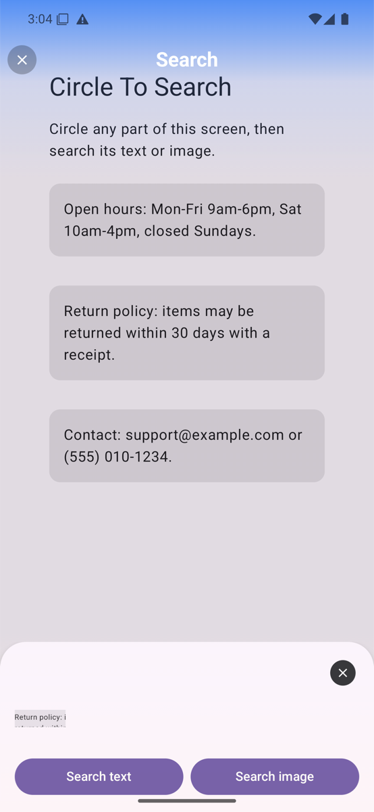

# Circle-To-Search

A Compose Multiplatform (Android + iOS) SDK, built on Material 3, for a Google Lens-style "circle
to search" gesture: users draw a lasso over on-screen content, then search either the recognized
text (on-device OCR) or the raw cropped image. Can be dropped onto any screen, with fully
customizable colors/tints, animated chrome, strings, OCR backend, and an overridable bottom bar.

## Demo

| Idle | Selecting | Result |
| --- | --- | --- |
|  |  |  |

## Install

Via [JitPack](https://jitpack.io/#krajarajan96/Circle-To-Search):

```kotlin
// settings.gradle.kts
dependencyResolutionManagement {
    repositories {
        maven(url = "https://jitpack.io")
    }
}
```

```kotlin
// your module's build.gradle.kts
dependencies {
    implementation("com.github.krajarajan96:Circle-To-Search:v0.1.0")
}
```

### iOS

Because this is a Kotlin Multiplatform library, the JitPack coordinate above works out of the box
**if your iOS app is itself a Kotlin Multiplatform Gradle project** (i.e. it has `iosArm64`/
`iosSimulatorArm64` targets and embeds a Kotlin/Native framework, like this repo's own `sample`
module does) — Gradle resolves the `iosArm64`/`iosSimulatorArm64` klibs from JitPack the same way
it resolves the Android `.aar`. Just add the dependency to your shared/common source set as above,
then build your `iosApp` framework normally (see [Building](#building) below for the pattern).

A plain Swift/Xcode-only app (no Gradle, no KMP) can't consume a Maven artifact directly — that
would require a prebuilt `.xcframework` distributed via CocoaPods or Swift Package Manager, which
this library doesn't publish yet. If you need that path, open an issue.

## Usage

```kotlin
SelectableContent(
    onResult = { result ->
        when (result) {
            is CircleSearchResult.TextQuery -> /* result.text, result.image */
            is CircleSearchResult.ImageQuery -> /* result.image */
        }
    },
) {
    // Your screen's content
}
```

### Customization

Pass a `CircleSearchConfig` to override colors, strings, the minimum selection size, the OCR
backend, or the bottom bar shown while selecting:

```kotlin
SelectableContent(
    onResult = { ... },
    config = CircleSearchConfig(
        ocrProvider = MyCustomOcrProvider(), // or OcrProviders.disabled() to hide text search
        colors = CircleSearchColors.defaults().copy(
            searchBarColor = Color.Black,
            contentColor = Color.White,          // text/icon tint across the chrome
            bottomGlowBrush = myBrandGlowBrush,   // accent glow anchored at the bottom edge
        ),
        strings = CircleSearchStrings.defaults().copy(searchTitle = "Find"),
        bottomBar = { MyCustomBottomBar() },      // fully replace the default search bar
    ),
) { /* ... */ }
```

#### Config options

| `CircleSearchConfig` field | Default | Purpose |
| --- | --- | --- |
| `ocrProvider` | `OcrProviders.default()` | Text-recognition backend (ML Kit / Vision), or `OcrProviders.disabled()`. |
| `colors` | `CircleSearchColors.defaults()` | Scrim, bars, glow, stroke, panel and FAB (`fabContainerColor`, `fabContentColor`) colors. |
| `strings` | `CircleSearchStrings.defaults()` | All copy, including `searchButton` and accessibility descriptions. |
| `minSelectionSizePx` | `20` | Smallest selection that counts as a deliberate circle. |
| `bottomBar` | `null` | Replace the default bottom bar with your own composable. |
| `showChrome` | `true` | `false` when the host draws `SearchModeTopBar` / `SearchModeBottomBar` itself. |
| `showFab` | `true` | `false` when the host launches search via `SelectionController.startSelecting()`. |
| `enableImageSearch` | `true` | `false` shows a single text-search button and never emits `ImageQuery`. |
| `resetOnEmptyText` | `false` | Close back to idle when OCR finds no text instead of emitting an empty `TextQuery`. |
| `onQuerySubmit` | `null` | Makes the default bottom bar a typeable field; called on IME search. |
| `onVoiceSearch` | `null` | Makes the mic in the default bottom bar tappable. |

`CircleSearchColors` exposes every color and brush used by the gesture overlay — the scrim, the
top/bottom bar gradients, the bottom glow, the selection stroke, and the dimming shown while
actively drawing — so a host app can reskin the whole experience without forking the library. The
top bar, bottom bar, and result panel all animate in/out (slide + fade), and the scrim/dimming
layers crossfade with them.

By default, `OcrProviders.default()` uses ML Kit on Android and the Vision framework on iOS.

## Modules

- `circletosearch` — the library (publish as `com.circletosearch:circletosearch`).
- `sample` — a minimal Android + iOS app demonstrating both the text-query and image-query flows.

## Building

```
./gradlew :circletosearch:build
./gradlew :sample:assembleDebug
```

The iOS sample app lives in `iosApp/` (open `iosApp/iosApp.xcodeproj` in Xcode); it embeds the
`sample` module's Kotlin/Native framework via the existing Gradle build.

## License

MIT — see [LICENSE](LICENSE).
